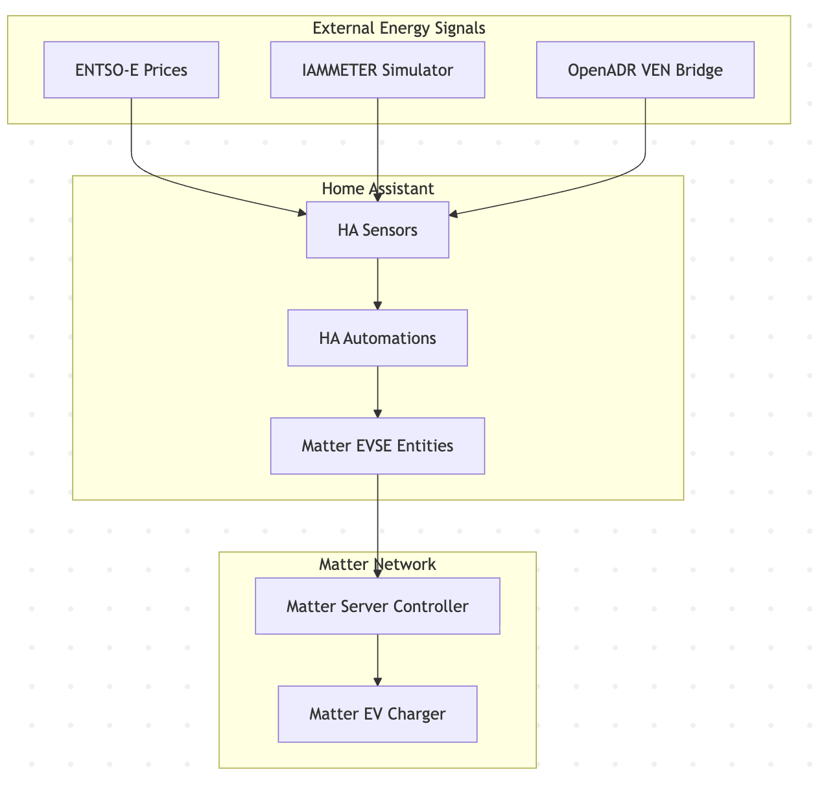

<!--
SPDX-FileCopyrightText: ElaadNL

SPDX-License-Identifier: Apache-2.0
-->

# Matter EVSE Onboarding

This page is the starting point for readers who are new to Matter and want to understand how this repository controls a Matter EV charger from Home Assistant.

## What This Project Connects

At a high level, Home Assistant does not talk directly to the EV charger over a custom EVSE API. It uses Matter entities that are backed by the Matter Server.

The main chain is:

The important idea is that Home Assistant automations work with Home Assistant entities, while the Matter Server handles the Matter controller side. When an automation turns on `switch.matter_evse_enable_charging`, Home Assistant maps that action to a Matter EVSE command.

## Core Matter Concepts

If you are unfamiliar with terms like Controller, Fabric, Node, Endpoint, Cluster, Attribute, Command, or Event, please read the Core Matter concepts section in [`matter-adopter-onboarding.md`](matter-adopter-onboarding.md) first.

In the context of Home Assistant, the only additional term you need is:

- **Home Assistant entity**: The Home Assistant representation of a device capability, such as `switch.matter_evse_enable_charging`.

## How Home Assistant Maps Matter EVSE

The Matter EV charger exposes Matter clusters, attributes, commands, and events. Home Assistant turns some of those into entities that automations can use.

Common examples in this repository:

| Home Assistant entity | Matter mapping | Why it matters |
| --- | --- | --- |
| `switch.matter_evse_enable_charging` | Sends `EnergyEvse.EnableCharging` (`0x02`) or `EnergyEvse.Disable` (`0x01`); reads `EnergyEvse.SupplyState` (`0x0001`) | Starts or stops EV charging from automations. |
| `number.matter_evse_user_max_charge_current` | Writes `EnergyEvse.UserMaximumChargeCurrent` (`0x0009`); also attempts `EnergyEvse.MaximumChargeCurrent` (`0x0007`) when supported | Sets the charging current limit used by solar-surplus control. |
| `sensor.matter_evse_min_charge_current` | Reads `EnergyEvse.MinimumChargeCurrent` (`0x0006`) | Shows the minimum current the EVSE can accept. |
| `sensor.matter_evse_max_charge_current` | Reads `EnergyEvse.MaximumChargeCurrent` (`0x0007`) | Shows the current EVSE maximum charge current. |
| `sensor.matter_evse_circuit_capacity` | Reads `EnergyEvse.CircuitCapacity` (`0x0005`) | Shows the hardware or circuit current limit exposed by the EVSE. |

## Where The Non-Matter Inputs Come From

Not every sensor in the use cases is a Matter sensor. The automations combine external energy inputs with Matter EVSE control.

| Input | Source | Used for |
| --- | --- | --- |
| ENTSO-E price sensors | ENTSO-E custom integration | Price-based charging. |
| IAMMETER simulator sensors | IAMMETER REST endpoint and Home Assistant template sensors | Solar surplus and grid import/export calculations. |
| OpenADR limit sensors | OpenADR VEN bridge publishing MQTT payloads | Peak grid demand limiting. |

## Reader Paths

If you are entirely new to Matter and HEMS integration, read [`matter-adopter-onboarding.md`](matter-adopter-onboarding.md) first to understand core concepts and commissioning.

If you only need to understand the demo flow, read this page first, then read [`evse-use-cases.md`](evse-use-cases.md).

If you need to validate whether a Matter EV charger exposes the required Matter surface, read this page first, then read [`evse-compulsory-cluster-test-guide.md`](evse-compulsory-cluster-test-guide.md).

If you need to develop against the Matter Server or understand the backend architecture, read this page first, then read [`project-overview-developer.md`](project-overview-developer.md).

## Key Point

For a newcomer, the most useful mental model is:

`External energy signals -> Home Assistant sensors -> Home Assistant automations -> Matter EVSE entities -> Matter Server -> EV charger`

The Home Assistant entity is the practical control surface. The Matter attribute or command is the protocol-level capability behind that entity.
