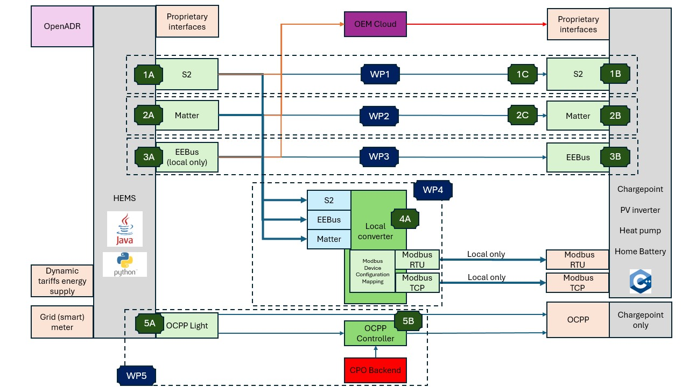

<!--
SPDX-FileCopyrightText: ElaadNL

SPDX-License-Identifier: Apache-2.0
-->

# Project Overview

This document provides background and scope for the Open Matter HEMS Connector.

---

## Purpose of This Repository

This repository contains the **HEMS side** of Matter interoperability: a Matter
controller server that commissions and controls energy devices, and exposes them
to a Home Energy Management System (HEMS) through a WebSocket API.

It is the counterpart to
[`resflex-open-matter-device-connector`](https://github.com/ElaadNL/resflex-open-matter-device-connector),
which provides EVSE simulator firmware that this connector is developed and
tested against.

Key goals:

- Provide a reference Matter controller for HEMS integration of flexible devices
- Demonstrate the residential flexibility use cases over Matter 1.4
- Keep the vendored upstream code traceable and correctly attributed
- Enable faster onboarding and reuse

---

## Residential Flexibility

This software was developed as part of the ElaadNL
[Residential Flexibility](https://elaad.nl/en/projects/residential-flexibility/)
initiative, part of the Dutch National Grid Congestion Action Program. The
initiative aims to improve interoperability between Home Energy Management
Systems (HEMS) and flexible energy-intensive devices (FEIDs) such as:

- EV chargers
- Home batteries
- Heat pumps
- Solar inverters

Open-source connectors are developed for the following open protocols:

- S2 (EN 50491-12-2)
- Matter 1.4
- EEBUS (SHIP/SPINE)
- Modbus RTU/TCP (via a converter)
- OCPP

---

## System Context

The HEMS acts as the central coordinator. It receives external signals (such as
grid capacity limits or dynamic prices) and manages connected devices
accordingly. These devices include EV chargers, batteries, heat pumps, and
inverters.

Each connector enables secure and interoperable communication between the HEMS
and a specific type of device, using an open protocol. This repository provides
that connection for Matter devices.
